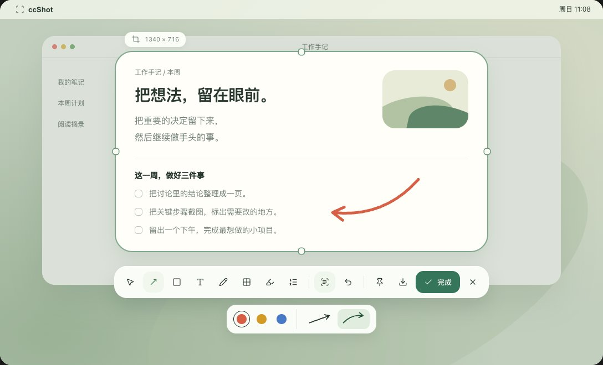

<p align="center">
  
</p>

<h1 align="center">ccShot</h1>

<p align="center">截完图，直接选字。免费的 macOS 原生截图、标注与钉图工具。</p>

<p align="center">
  <a href="https://ccshot.app/">官网</a> ·
  <a href="https://download.ccshot.app/ccShot-0.1.0-macos-arm64.dmg">下载 Mac 公开预览版</a> ·
  <a href="https://github.com/chendashi1024/ccShot/releases/tag/v0.1.0">GitHub Release</a> ·
  <a href="CHANGELOG.md">更新日志</a> ·
  <a href="https://github.com/chendashi1024/ccShot/issues">问题反馈</a>
</p>



## 截图之后，少走几步

- **直接选字**。截图后在图上拖选需要的文字，按 ⌘C 复制。识别在本机完成，离线可用。
- **截图和标注**。支持区域、窗口和当前屏截图。可添加、调整箭头、画框、文字、画笔、遮挡、高亮和序号。
- **桌面钉图**。把截图留在桌面上对照，需要时继续编辑，也能将剪贴板图片钉在桌面。
- **保存**。用系统窗口选择文件夹，支持 PNG、JPG，也可设定默认位置。

基础截图、标注与识字无需账号或 API Key。AI 和截图美化尚未随首版发行。

## 下载与安装

| 版本 | 芯片 | 系统要求 |
| --- | --- | --- |
| [v0.1.0 公开预览版](https://download.ccshot.app/ccShot-0.1.0-macos-arm64.dmg) | Apple Silicon（arm64，M 系列） | 构建目标为 macOS 14 或更新版本 |

1. 下载 [DMG](https://download.ccshot.app/ccShot-0.1.0-macos-arm64.dmg)。同一文件也可从 [GitHub Releases](https://github.com/chendashi1024/ccShot/releases/download/v0.1.0/ccShot-0.1.0-macos-arm64.dmg) 下载。SHA-256 为 `24bf3982b6d282085ad5fe19ab96b42946c9841fa575a9f6737a188004a9fcfb`，对照 [校验文件](https://download.ccshot.app/ccShot-0.1.0-macos-arm64.dmg.sha256)。打开后将 **ccShot.app** 拖入「应用程序」。
2. 首版采用临时签名，未经 Apple 公证。若系统阻止首次打开，在确认来源和 SHA-256 后，前往「系统设置 → 隐私与安全性」选择「仍要打开」。参见 [Apple 的打开应用说明](https://support.apple.com/zh-cn/102445)。
3. 打开 ccShot，点击菜单栏的四角 C 图标，选择「区域截图」。按提示允许屏幕录制，再重新打开 App。

维护者在一台 Apple Silicon、macOS 15.4.1 上安装并打开过。这不是全部机型、干净设备、实体快捷键或混合缩放多屏的验收。没有 Intel 安装包。完整标注烟测仍有已知失败，详见[更新日志](CHANGELOG.md)。

## 常用操作

| 操作 | 默认方式 |
| --- | --- |
| 开始截图 | F1，或从菜单栏进入。功能键模式下可试 Fn+F1，默认备用键为 ⌃⌥S |
| 复制 | ⌘C 复制当前选中文字或图片，保留编辑窗 |
| 完成 | Return 或点「完成」，复制后关闭编辑窗 |
| 钉图 | F3，或从菜单栏选择「钉住剪贴板」 |

更新时退出 App，从 [GitHub Releases](https://github.com/chendashi1024/ccShot/releases) 下载新版，替换「应用程序」里的旧版。升级后若无法截图，在系统设置中重新授权。

## 从源码构建

需要 Apple Silicon Mac 和 Xcode 命令行工具。原生 App 使用 Swift、AppKit、ScreenCaptureKit 和 VisionKit。

```bash
bash app/build.sh
open app/build/ccShot.app
bash app/check.sh --core-only
```

详见[开发说明](app/README.md)、[贡献指南](CONTRIBUTING.md)和[发布流程](docs/发布流程.md)。

## 许可证

[MIT](LICENSE)
