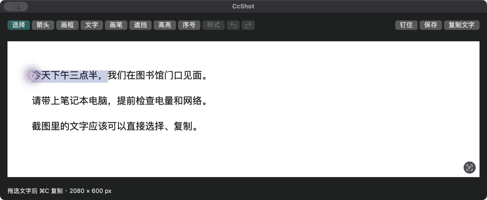

# ccShort

免费的 Mac 原生截图标注项目。截图后直接拖选文字，常用标注、复制、保存和钉图就在手边；本地功能不需要账号、网络或 API Key。



## 当前状态

已进入可运行的本地开发版：区域/窗口/当前屏截图、选区调整与取色、本地选字、可编辑标注、PNG/JPG输出及钉图已接入。首排提供箭头、画框、文字、画笔、遮挡、高亮和序号，样式按需展开；设置只保留截图快捷键和保存位置。

AI、美化与高级设置按最新要求延期，完整44项需求继续保留台账。当前不是正式发布版；实际双2x屏及PNG/JPG保存已实测；已修复整屏捕获只取逻辑尺寸的问题；系统中文候选、实体全局快捷键、混合缩放与安装验证仍在进行，不把已实现等同全部验收通过。

## 本机运行

使用本机已有 Xcode。当前构建目标为 macOS 14、Apple Silicon，仅在本机 macOS 15.4.1 验证。

```bash
cd app
bash build.sh
open build/ccShort.app
```

点菜单栏的四角 C 图标，选择 **区域截图**。默认 F1（部分系统设置下需 Fn+F1）或 Control+Option+S；F3 钉住当前截图或剪贴板。区域确定后进入原生编辑窗，直接拖选文字，或使用首排工具；回车复制截图并关闭编辑窗；拖选文字后用 ⌘C 复制文字。钉图空格进入编辑，右键可保存和调整查看透明度。

截图需要屏幕录制权限；权限未具备时可从引导打开系统设置，由本人添加或允许后重开应用。开发包采用本地 ad-hoc 签名，尚未做公开安装与升级验收。

## 验证与文档

```bash
cd app
bash check.sh
```

检查包括选区坐标、对象历史、真实视图事件、图片/剪贴板、原生文字输入与遮挡后的安全识字；硬件与实际操作的未测边界单列。

| 文档 | 内容 |
|---|---|
| [GOALS.md](GOALS.md) | 当前范围、后续计划和完成定义 |
| [HANDOFF.md](HANDOFF.md) | 真实进度、证据和限制 |
| [app/README.md](app/README.md) | 构建、操作、原生截图与聚焦验证 |
| [功能清单与验收标准](docs/功能清单与验收标准.md) | 原44项编号和验证台账 |
| [开发阶段与任务拆解](docs/开发阶段与任务拆解.md) | 核心优先的执行顺序 |
| [UI参考与设计](docs/UI参考与设计.md) | 自制设计候选与原生接入状态 |
| [原PRD](docs/PRD.md)、[决策记录](docs/决策记录.md) | 历史需求及最新补充 |
| [AGENTS.md](AGENTS.md) | 项目执行规则 |

## 许可证

暂定 MIT，待作者最终确认；尚未公开发布。
