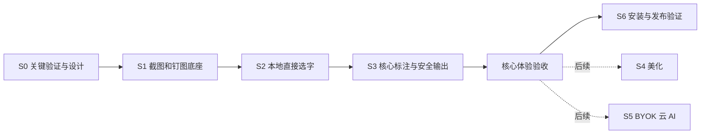

# CcShot · 开发阶段与任务拆解

版本：v0.1｜日期：2026-11-03｜状态：执行草案；不是开发完成记录或三周工期承诺。

**先做好截图、选字、常用标注、复制/保存与钉图；当前界面和设置极简。** 按 2026-11-03 最新用户要求，AI、美化、高级工具后续再排；下文保留[原44项任务](功能清单与验收标准.md)作为台账，不能把旧的全量阶段门槛套在当前核心体验版上。当前范围以 [GOALS](../GOALS.md) 为准，真实开发进展见 HANDOFF。

入口：[GOALS](../GOALS.md) · [HANDOFF](../HANDOFF.md) · [未决项 D01–D12](功能清单与验收标准.md#decisions)

## 1. 执行方法与依赖

- 当前核心路径通过即可交付“核心体验版”；S4/S5 及高级工具不作为前置。必须标明安装/发布验证与延期范围，不能称44项全部通过。
- 各任务表的工时为单人有效工作时间的粗估范围，包含对应直接检查，不含等待硬件、授权、用户决定和未知缺陷修复；S0 后重估。代码生成速度不能替代原生运行验收时间。
- 所有任务初始为**未分配、未开始产品级验收**。领取时按 HANDOFF 的任务卡记录负责 Agent、文件边界、状态及证据；不要默认当前已有“通过”。
- 先查真实生产者、消费者和已有工程。按小模块做最小修改，运行直接相关正常/失败/回归检查，再审查差异；不要求每改一行就跑整套矩阵或写新计划。
- 多个 Agent 只有在具体任务授权且文件/状态独立时才分工。截图会话、输入路由、坐标变换、共享渲染/脱敏管线由明确的同一负责人连续整合，不能多方同时重写。
- 另一会话已完成 `prototype/local-ocr/` 技术原型和正式报告（本地提交 `23675b4b`）。本次只读核对、不运行或改它；后续负责人先读取其交接证据和已知失败，再决定哪些检查仍缺，避免重复建设或覆盖他人工作。

## 2. S0：关键验证与设计

**目的：** 查清系统和交互边界；不把“SDK可编译”“注册成功”“单个样本可复制”当作端到端通过。

| 任务 ID | 做什么 / 产物 | 关联范围 | 依赖 | 完成标准 | 粗估 |
|---|---|---|---|---|---|
| S0-01 | 核对目录、适用规则、44项范围及原型交接；建立最小证据索引和真实构建入口记录 | 全部44项 | 仓库可读、当前任务范围明确 | 原编号无漏项；已有改动/原型路径/未测项清楚；不猜工程或测试命令 | 1–2h |
| S0-02 | **高风险：** 验证目标SDK/API、最低OS/架构、截图权限、多屏坐标、px/pt及色彩约定；形成D01/D08建议 | #4–#9、#51，平台基础 | S0-01；相应设备/可用原型 | 官方资料日期/链接和实际测试分开；单屏及混合缩放证据清楚，缺硬件写未测 | 4–8h |
| S0-03 | **高风险：** 复核本地识别叠层、真实鼠标选字、程序化边界缺陷和真实全局热键；形成D05及OCR风险结论 | #1、#36–#38、#51/#52 | S0-01；由原型负责人提供证据或另行明确可执行范围 | 按OCR-10/CAP-08区分已证实和未证实；记录四字样本不代表全文正确；不擅自改成只复制全部 | 6–12h |
| S0-04 | 参考板、四个关键画面、输入状态表、OCR数据集与测量口径；汇总D10/D11及工期 | UI-01–05、全部质量目标 | S0-01；S0-02/03结果用于修订 | 视觉来源可追溯、自己设计；明确Esc/复制/焦点；确定样本和设备，用户确认核心方案后才能开依赖的产品开发 | 5–8h |

**阶段门槛：** D01、D05、D08、D11有可执行结论；截图+本地选字技术路径有可核验证据，已知选择边界问题有处理结论；D10定义测量口径。未决云 AI 厂商不阻塞此阶段。现有正式原型报告证明受控窗口快照和鼠标拖选，但全局唤起、程序化范围边界、混合多屏等仍未通过/未测，不能标S0全部通过。

## 3. S1：截图、输出和钉图底座

| 任务 ID | 做什么 / 产物 | 原编号 | 依赖 | 完成标准 / 直接检查 | 粗估 |
|---|---|---|---|---|---|
| S1-01 | 菜单栏生命周期、F1/F3/自定义快捷键、首次权限引导和退出清理 | #1、#2 | S0；D01/D05/D11 | CAP-01/07/08；真实其他App前台按键可唤起，拒绝/撤回可恢复，退出无残留 | 4–6h |
| S1-02 | **高风险：** 区域/窗口/当前屏捕获；定义捕获快照与显示器身份 | #4、#5、#6 | S1-01；D08 | CAP-02/03/04；负坐标和混合缩放正确，自家控件不入图，窗口消失不拿错目标 | 6–10h |
| S1-03 | 八控制点、移动/微调、放大镜、色值复制及贴边浮层 | #7、#8、#9 | S1-02；D08/D11 | CAP-05/06、UI-01/02；像素标尺与HEX/RGB吻合，输入不被截获 | 4–6h |
| S1-04 | 当前图复制、PNG/JPG保存、目录选择、错误反馈 | #49、#50 | S1-02；输入路由 | OUT-01/02；两种原生App粘贴正确，取消/拒绝/写失败保留会话 | 3–5h |
| S1-05 | 钉图窗口、多图独立、移动缩放透明度、剪贴板图片/文字钉图 | #51、#52 | S1-04；坐标契约 | PIN-01/02；空剪贴板提示、跨屏可操作，保留源像素和以后接入图层的会话引用 | 5–8h |
| S1-06 | 当前设置先保留截图快捷键、保存目录、合法偏好恢复；必要权限和错误就近提示 | #55（核心部分） | S1-01/04 | SET-01、CAP-08；偏好与实际状态一致，不展示 AI 占位或默认 OCR 开关；登录项后续 | 2–4h |

**阶段门槛：** 目标显示器矩阵完成30次捕获→复制→钉图/关闭循环，无错屏、偏移、遮罩残留、崩溃或热键失效；权限拒绝和恢复通过。无Key、断网可走全流程。OCR和完整标注尚未完成时如实标注。30次仅为早期稳定性冒烟建议，D10冻结后执行，不代替最终回归。

## 4. S2：本地直接选字

| 任务 ID | 做什么 / 产物 | 原编号 | 依赖 | 完成标准 / 直接检查 | 粗估 |
|---|---|---|---|---|---|
| S2-01 | 本地识别服务与会话/图像版本绑定；取消/迟到结果、无字/失败状态 | #36 | S1捕获会话；S0-03技术结论 | OCR-01/03/04/07；无网可识别，不抢焦点，不串图，失败仍可输出图 | 4–8h |
| S2-02 | **高风险：** 编辑和钉图直接拖选、字符边界、复制全部/部分、阅读顺序及变换 | #36、#37、#51（选字部分） | S2-01、S1-05；D08/D10 | OCR-02/06/10；识别CER、顺序和命中分别出证据；不能把程序化多一字问题隐藏在平均准确率里 | 6–10h |
| S2-03 | 选择/绘制/输入优先级，Esc与复制；标注接入点、结果更新不打断操作 | #38（基础） | S2-02；D11 | OCR-04/05/09、UI-02；此阶段可测替代工具状态，S3接入真实九工具后必须再验 | 3–6h |

**阶段门槛：** 真实App编辑/钉图上的普通样本可选可复制，首尾/单字/四字/跨行用例精确；多屏与缩放对齐；无网络；CER/顺序/选择报告分开，性能目标有基线或偏差说明。只有文本面板出现识别结果不算通过。

## 5. S3：核心标注优先，完整工具保留后续

当前先完成 S3-01、S3-02 中的矩形/箭头、S3-03 画笔/高亮/序号、S3-04 中文文字/实心遮挡与安全 OCR，再接 S3-05 的样式记忆、钉图编辑。用户已要求常用功能首排直达，不能以「核心版」为由藏进标注入口；具体低频扩展另排，已写工具不删除。实心遮挡不能算 #18 全部能力通过；工具与输出保持一排，样式按需展开。

| 任务 ID | 做什么 / 产物 | 原编号 | 依赖 | 完成标准 / 直接检查 | 粗估 |
|---|---|---|---|---|---|
| S3-01 | 可编辑对象、命中/控制点、撤销重做事务、统一合成入口 | #21、#22 | S1输出、S2输入/坐标 | ANN-01/03/04；对象不破坏底图，混合100步历史一致；缺少具体工具的最终验收待后续接入 | 5–8h |
| S3-02 | 矩形/椭圆/箭头/直线，适用参数及Shift吸附 | #12、#13、#14、#15 | S3-01 | ANN-01；四工具完整编辑和极值/取消，输出和撤销一致 | 4–6h |
| S3-03 | 平滑画笔、半透明高亮、递增序号及起始号 | #16、#19、#20 | S3-01 | ANN-01/03/04；快慢笔画、叠涂、撤销后序号均正确 | 4–6h |
| S3-04 | **高风险：** 中文文字标注、马赛克/模糊、实心遮挡用法与安全OCR失效 | #17、#18 | S3-01、S2；当前可见内容合同 | ANN-04/05、OCR-08/09；输入法正常，被遮挡原文不从复制/载荷旁路泄漏 | 6–10h |
| S3-05 | 就地样式条、独立样式记忆、钉图保留对象并继续编辑；九工具与选字联调 | #23、#24、#25、#38（完整） | S3-02/03/04、S1-05 | ANN-02/06、PIN-03、UI-01/02；切工具/重启不串值，实际标注和OCR不冲突 | 4–8h |

**当前阶段门槛：** 核心工具逐一完成创建→改样式→移动/缩放→撤销重做→复制/保存→钉图再编辑；中文输入法、快捷键、对象/OCR命中和安全文字输出通过。完整九工具的验收留待恢复对应范围；标注“图像上看着正常”不足以证明隐私与编辑模型正确。

## 6. S4：美化与统一输出

| 任务 ID | 做什么 / 产物 | 原编号 | 依赖 | 完成标准 / 直接检查 | 粗估 |
|---|---|---|---|---|---|
| S4-01 | 复用同一合成管线，B预览、像素/比例、复制保存钉图统一结果 | #28、#30、#33 | S3合成/安全文本；D11 | BEAUTY-01/02/04；默认1920×1080真实文件，长宽图不拉伸/裁切，文字层映射正确 | 4–7h |
| S4-02 | 8–12渐变/纯色、阴影圆角内边距、上次一套预设恢复 | #29、#31、#32 | S4-01 | BEAUTY-02/04、SET-01；参数极值、取消取色、重启、三输出一致 | 3–5h |
| S4-03 | 本地图片背景及模糊、方向/资源大小/授权失败处理 | #34 | S4-01；D03默认保留 | BEAUTY-03/04；EXIF/丢失/损坏/巨图可恢复；无用户延期记录则必须实现 | 3–5h |

**阶段门槛：** 默认像素与各比例实测；透明图/极端图/全部背景类型无意外裁切；三种输出一致，原图标注/OCR正确。至此可提供本地体验版，云AI和自动更新未完成需明确标示。

## 7. S5：用户自配 Key 的云 AI（后续接入）

此阶段才处理厂商与模型。DeepSeek仍按当前方向暂停，不将旧预设表直接写入代码。D06需确定首批及最终范围；未核验厂商不能宣称兼容。没有授权Key/费用时可用假服务验证协议和错误路径，但真实请求保持未测试。

| 任务 ID | 做什么 / 产物 | 原编号 | 依赖 | 完成标准 / 直接检查 | 粗估 |
|---|---|---|---|---|---|
| S5-01 | 单页AI配置、可编辑端点/模型/能力/发送方式、钥匙串及最小测试连接 | #45、#46、#55（AI部分） | D06/D09；S1设置 | SEC-01/02/04/05；拒绝不明文回退，测试连接不带截图，端点改动不误发旧Key | 4–6h |
| S5-02 | 被确认协议适配、流式解码、图片/安全文字载荷和能力降级 | #41、#44、#45 | S5-01、S3安全合成 | AI-02/03/04/08；中文拆字节无乱码，只有图片能力错误降级一次，空OCR不盲发 | 6–10h |
| S5-03 | 按需侧栏、五快捷提问、自输、同图追问/复制回答；按D04接钉图 | #41、#42、#43 | S5-02；D04/D11/D12 | AI-01/06/09、UI-01–04；键盘和输入法一致，发送动作明确，无假回答 | 4–8h |
| S5-04 | **高风险：** 取消、迟到结果、切图/遮挡使上下文失效、错误恢复与日志检查 | #41、#43、#44、#46 | S5-02/03 | AI-03/05/08、SEC-02/03/04；不串图、不泄漏原文、取消不重发；本地功能不受影响 | 4–8h |
| S5-05 | 已确认厂商逐项官方核验；在实际授权范围内最小真实请求和演示 | #41–#46 | D06；凭证/费用授权；S5-04 | AI-07；记录文档核验/假服务/真实请求三个层次；缺Key项不标实测通过 | 2–5h |

**阶段门槛：** 假服务成功/故障矩阵通过，且至少一条真实可演示的已确认服务路径；逐家验证状态准确，#45范围已解决。未测厂商/未批准延期不能被一条成功路径覆盖。演示不得伪造服务商回答。

## 8. S6：发布候选和作品展示

| 任务 ID | 做什么 / 产物 | 原编号 | 依赖 | 完成标准 / 直接检查 | 粗估 |
|---|---|---|---|---|---|
| S6-01 | 按D02执行Sparkle首发，或记录用户明确延期；更新网络默认按D09 | #56 | D02/D09；当时官方更新/签名文档 | REL-02、SEC-03；校验错误/取消/失败不破坏旧版，延期不能标实现通过 | 4–8h |
| S6-02 | **高风险：** 可复现构建、ad-hoc打包、候选.zip/.dmg、版本/校验值、安装升级权限验证 | 全部交付，#55/#56 | D01/D07、S1–S5；构建工具已可用 | REL-01/03；干净环境可安装，未测架构明列，包对应源码；本地打包不等于公开发布 | 4–6h |
| S6-03 | 44项证据复核、适用矩阵、OCR/性能/多屏和可靠性实测 | 全部44项 | D10；相应设备和构建 | 按功能验收第5/6节；缺证据、失败和未测明确；不能改阈值过关 | 4–8h |
| S6-04 | 中英文README、真实短演示、许可证/依赖声明、构建测试/贡献说明、问题模板及发布草稿 | 全部交付 | S6-02/03；D07；可用试用者 | REL-04；首次安装卡点可追踪，宣传与真实能力一致，GitHub下载/演示入口清晰 | 4–6h |

**阶段门槛：** 全部44项有实际证据或用户批准的调整；关键路径和数据安全无阻塞；性能偏差/未测系统明确；候选安装和新人试用有结果。若仍缺受支持硬件或厂商验证，只能按实际覆盖范围报告，不宣称全部MVP完成。公开发布/推送/外发按当时授权执行。

## 9. 与原三周排期的关系

| 原设想 | 当前建议顺序 | 说明 |
|---|---|---|
| 第1周截图/钉图 | S0关键验证 + S1 | 先证明真实全局热键、捕获坐标和选字叠层，避免后面重做底座。 |
| 第2周标注+选字 | S2先做本地选字，再S3完整标注 | 同样保留九工具和样式；将最核心亮点的可行性提前。 |
| 第3周AI+美化+发布 | S4美化本地体验 → S5云AI → S6候选包 | 符合用户“先本地一版”；不以九类厂商接入阻塞本地体验版。 |

以上30个任务粗估合计 **122–213人时**，不是实测工时；按每天8小时约15–27个工作日，且未含等待/未知修复。单人三周只接近估算下界，存在明显风险。S0完成后给出更新估算与最早可试用的本地版本，不自行把基础功能删掉来兑现三周。

若 #34/#56 或云AI部分确需推迟：列出原编号、已经完成部分、延迟原因、用户选择和新的版本边界；保留44项来源追踪。没有决定时，称“阶段交付/本地体验版”，不称“完整MVP”。

## 10. 每次任务交接

领取最小可检查任务，写清原编号、依赖决定、文件范围、产物、正常/失败/回归验收和证据。任务未通过时只停止依赖它的工作；文档、设计或不共享状态的独立任务可继续。

每次回报回答：实际完成什么、在哪里、如何测过、当前阻塞是什么、下一项能否开始。具体格式和可直接复制的 Agent 启动指令见 [HANDOFF](../HANDOFF.md#agent-start)。本文件不构成安装购买、修改其他线程、增加权限或公开发布的授权。
